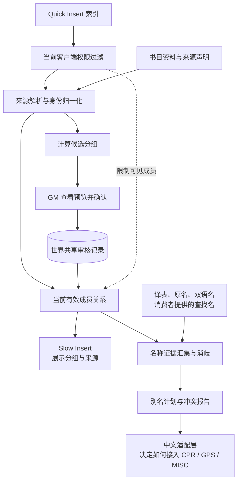
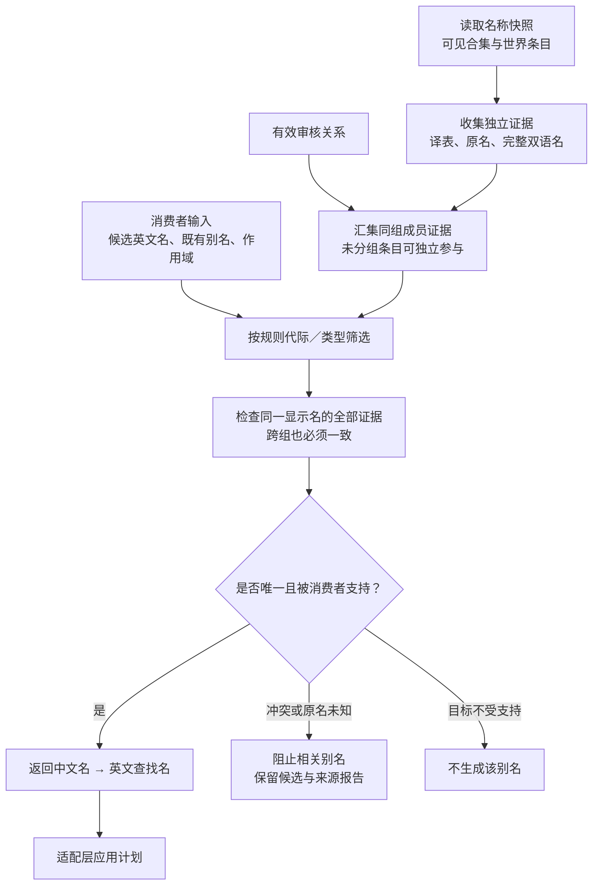
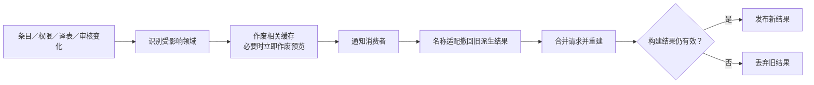
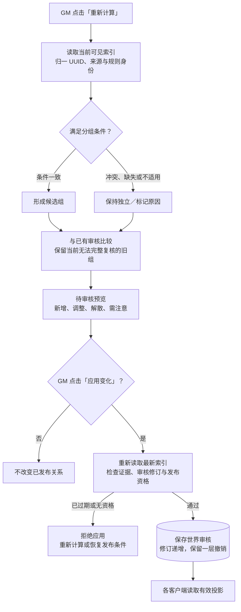

# Truesight 架构

Truesight 独立于搜索界面和自动化适配插件。来源解析、条目聚类和名称解析在基座内部单向分层；各消费者通过公共 API 读取结果，不复制内部算法。

## 工作流程总览

基座先确认哪些条目属于同一规则内容，再汇集名称证据。候选分组经过 GM 确认后进入世界审核；搜索与名称适配读取同一份审核的当前有效投影。

## 基座接口与快照

基座在 Foundry `init` 发布 `apiVersion: 1`，分为 `catalog`、`names`、`sources` 三个命名空间。目录与审核 API 见 [Truesight 说明](../module/README.md)。以下函数位于 `api.names`，其 `apiVersion` 也为 1。该版本是接口版本，不是插件发行版本。适配层只接受兼容的接口版本，不支持时保留原查找。

- `loadCorpus({fields})`：使用当前 Foundry 客户端读取快照；`readCorpus(...)` 是可注入数据源的同一加载过程，用于测试。同一客户端、权限与证据修订下合并字段需求并复用元数据；每批并发读取至多八个合集，失败时等待本批请求结束才允许下一轮。返回仅含所需字段的独立副本，不在适配器之间复用可变计划。
- `collectNamePairs(...)`：归一译表名称对，保留来源及可确认的类型、规则代际。ID 键使用本次快照恢复原名；缺少上下文的证据保持未限定，不凭显示名猜代际。
- `itemGroups(...)`：仅消费聚类层返回的有效审核成员关系，记录普通名称证据；适配层可传入额外证据提取函数。目录不可用或形状不符时失败，不创建替代分组。
- `planAliases({pairs, lookupNames, existingAliases, groups, scope})`：纯计算，返回 `{aliases: Map, report}`；不修改参数、名称表或文档。

作用域由适配层指定。`scope: null` 要求所有同名键全局一致；指定 `{rules, type, types}` 时，先排除已知不属于该作用域的证据和成员。未限定证据仍参与歧义检查。共享字段 `lookupNames` 表示额外的已确认查找名，不替代系统的 `system.identifier` 或提供方自己的标识。

计划先收集独立证据，再检查共用显示名的组。一个组的推断不会成为另一个组的新证据。已命中的完整双语名、明确原名和既有映射都保留来源；未命中的双语弱推测不能制造冲突，也不能单独发布别名。

### 名称解析流程

已审核成员关系决定哪些条目的名称证据可以汇集；能否生成别名，还要结合消费者的查找目标与作用域检查歧义。

## 消费者边界

Slow Insert 使用公开的 `api-v1.mjs`；中文适配插件使用 `game.modules.get("truesight").api.names`。基座只依赖 Quick Insert，不依赖这两个开发项目，也不包含 CPR、GPS 或 MISC 的查找入口。

## 变更通知

`truesightChanged` 的 `changes` 是影响领域集合。目录、名称适配和审核窗口分别消费所需领域，不以任意 Foundry 文档更新作为全量重建理由。设置只监听目录权限、索引范围、语言、译表和已知提供方候选配置；世界审核由原生设置 onChange 同步，按修订去重后通知，个人偏好不改变共享证据。

身份、权限、来源及审核变化立即作废未应用预览；通知可合并，但不能延迟预览校验。权限通知不等待普通事件批次，并在 QI 的其余文档钩子完成后合并一次结算刷新，防止授权恢复时缓存仍保留旧索引。风险规则使用完整原名作为身份依据，因此风险审核／预览存在时名称变化保守作废预览。

## 状态与构建生命周期

`catalog.getStatus()` 只检查就绪／可用状态，不调用 QI 搜索。`revisions` 分别记录 `index`（目录元数据）、`sources`、`names`、`access`、`review` 的失效代次；它们是客户端缓存令牌，不是世界共享审核修订。

目录按索引对象和元数据代次复用全量搜索结果；每次读取仍过滤当前权限，权限投影变化会换掉归一化缓存。来源修订重建来源上下文；审核修订只重建成员投影。预览与读取共享归一化元数据，但计算使用独立记录，不能改写缓存。应用预览时强制读取新索引并校验证据。

名称快照按当前客户端、世界、用户、角色、语言、译表启用情况、可见合集和世界条目以及证据修订缓存；字段集合按各消费者需求合并。返回的 `isCurrent()` 可在异步发布前检查证据与权限是否仍有效。审核关系由 `catalogFor` 读取当前投影，不缓存提供方计划。Babele 的批量就绪、数据加载及重初始化事件使名称证据失效，不监听逐条翻译钩子。

`names.createRefreshQueue({invalidate, build})` 为每个消费者维护一个运行任务和一个最新请求。`request()` 同步撤回旧结果，下一微任务开始构建；`build(isCurrent)` 发布前检查令牌，`stop()` 作废在途结果与排队请求。旧构建失败不阻断较新的请求。调用方自行保留其提供方作用域、报告和可变计划。

性能夹具运行 `npm run benchmark -- 20000`。扫描／归一化计数有断言，时间只描述本机合成数据，不等同于 Foundry 实机性能。

## 世界审核与发布

重新计算生成本客户端的候选预览，应用时再校验证据与发布资格。普通索引刷新只更新已有审核的有效投影，不自动发布新的成员关系。

`truesight.review` 是隐藏的原生世界设置，保存审核快照、身份排除、一层撤销、单调修订、发布用户和发布时间。它是共享权威记录；`catalog.read()` 是当前客户端按权限与身份指纹产生的有效投影。玩家没有管理入口与管理 API 权限，仍可读取正常搜索和名称适配需要的结果。世界设置遵循 Foundry 原生权限，不承担额外的数据保密。

重新计算仅替换当前索引能够完整观察的关系。缺项的旧组整体保留，不能把当前索引范围、权限或临时加载状态误当成权威删除；新候选不能借保留组的相同语义键自动加入旧组。身份失效仍在读取投影时立即生效。

原生 `game.users.activeGM` 决定发布用户；同一用户的客户端通过模块通信报告会话，只有单一会话可写。发布前检查世界设置修订，单实例拒绝重入保存，保存成功后才安装结果。设置回调与保存回执共用接收路径，旧回执不覆盖新修订，同修订不同内容明确报冲突。发布资格改变使预览失效，发布中的旧会话阻止另一个会话接管写入。

会话协调用于可信客户端的普通操作，不是数据库级比较交换或对具有世界设置写权限用户的防篡改机制。异常断线不按超时擅自清除仍可能执行写入的会话；恢复操作是关闭多余客户端并重新载入。世界审核读取不依赖发布会话在线。
