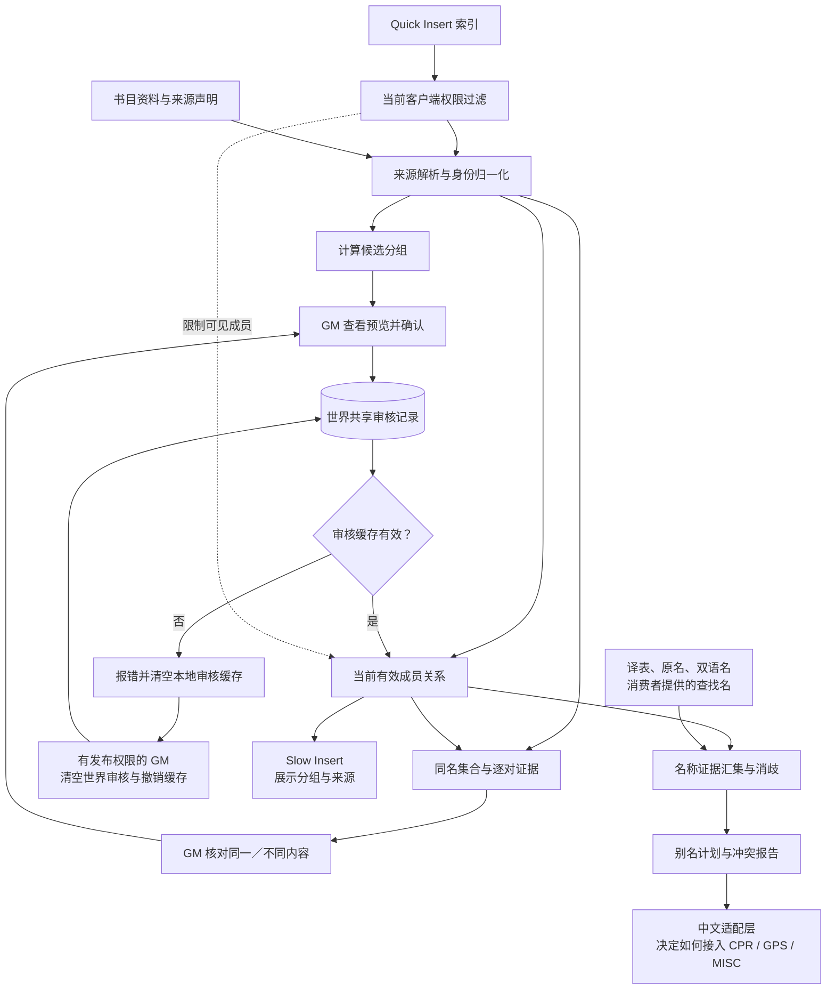
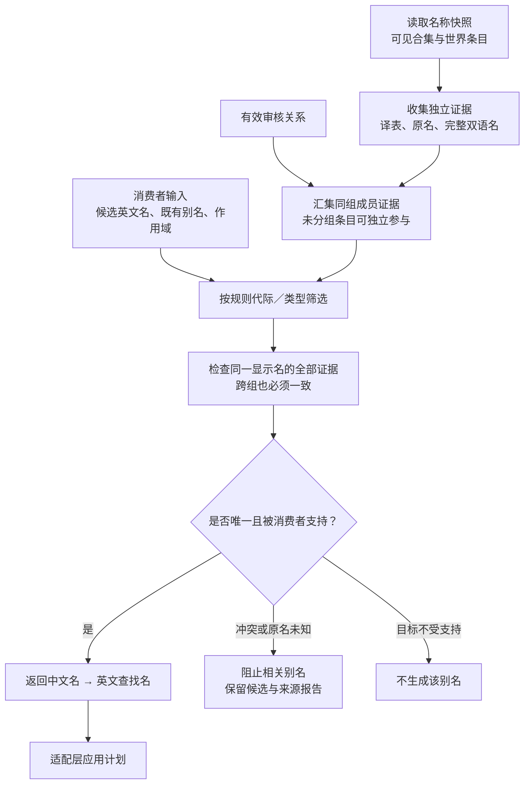
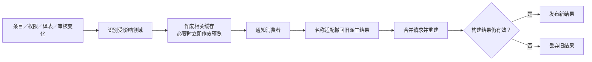
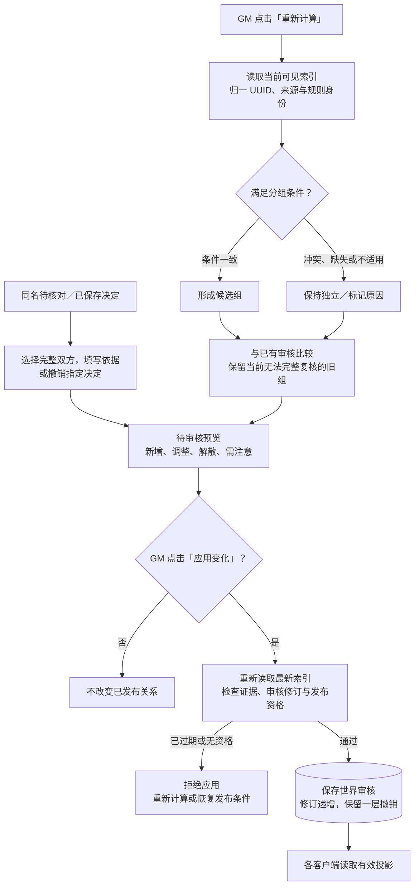

# Truesight 架构

Truesight 独立于搜索界面和自动化适配插件。来源解析、条目聚类和名称解析在基座内部单向分层；各消费者通过公共 API 读取结果，不复制内部算法。

## 工作流程总览

基座先确认哪些条目属于同一规则内容，再汇集名称证据。候选分组经过 GM 确认后进入世界审核；搜索与名称适配读取同一份审核的当前有效投影。

## 基座接口与快照

基座在 Foundry `init` 发布 `apiVersion: 1`，分为 `catalog`、`names`、`sources` 三个命名空间。目录与审核 API 见 [Truesight 说明](../module/README.md)。以下函数位于 `api.names`，其 `apiVersion` 也为 1。该版本是接口版本，不是插件发行版本。适配层只接受指定的接口版本，不支持时保留原查找。

- `loadCorpus({fields})`：使用当前 Foundry 客户端读取快照；`readCorpus(...)` 是可注入数据源的同一加载过程，用于测试。同一客户端、权限与证据修订下合并字段需求并复用元数据；每批并发读取至多八个合集，失败时等待本批请求结束才允许下一轮。返回仅含所需字段的独立副本，不在适配器之间复用可变计划。
- `collectNamePairs(...)`：归一译表名称对，保留来源及可确认的类型、规则代际。ID 键使用本次快照恢复原名；缺少上下文的证据保持未限定，不凭显示名猜代际。
- `itemGroups(...)`：仅消费聚类层返回的有效审核成员关系，记录普通名称证据；适配层可传入额外证据提取函数。目录不可用或形状不符时失败，不创建替代分组。
- `planAliases({pairs, lookupNames, existingAliases, groups, scope})`：纯计算，返回 `{aliases: Map, report, disambiguation}`；不修改参数、名称表或文档。
- `resolveItemAlias(plan, item)`：在全局名称冲突时，按已审核同源组／`_stats.compendiumSource`、条目自身的 `originalName`、`system.identifier` 与完整双语名顺序消歧；任一步骤命中明确英文原名但不受当前提供方支持时直接止步，不降级猜测。

作用域由适配层指定。`scope: null` 要求所有同名键全局一致；指定 `{rules, type, types, category, excludeCategories, actorType}` 时，先排除已知不属于该作用域的证据、特性类别与所属角色类型（如 NPC 内嵌特性不混入玩家角色查找）。未限定证据仍参与歧义检查。共享字段 `lookupNames` 表示额外的已确认查找名，不替代系统的 `system.identifier` 或提供方自己的标识。

计划先收集独立证据，再检查共用显示名的组。一个组的推断不会成为另一个组的新证据。已命中的完整双语名、明确原名和既有映射都保留来源；未命中的双语弱推测不能制造冲突，也不能单独发布别名。

### 名称解析流程

已审核成员关系决定哪些条目的名称证据可以汇集；能否生成别名，还要结合消费者的查找目标与作用域检查歧义。

## 消费者边界

Slow Insert 使用公开的 `api-v1.mjs`；中文适配插件使用 `game.modules.get("truesight").api.names`。基座只依赖 Quick Insert，不依赖这两个开发项目，也不包含 CPR、GPS 或 MISC 的查找入口。

## 变更通知

`truesightChanged` 的 `changes` 是影响领域集合。目录、名称适配和审核窗口分别消费所需领域，不以任意 Foundry 文档更新作为全量重建理由。钩子只监听 Quick Insert 实际索引的文档类型，忽略 `ActiveEffect`、`ChatMessage`、`Combatant` 等非索引类型以及合成 Token 文档；未开启 `embeddedIndexing` 时，角色卡内嵌物品仅在中文显示名或对应名称证据变化时发出仅含 `names` 的通知（不触发 `index`、`packs` 重建或预览失效），空世界角色与纯英文非宿主世界物品不唤醒名称适配。设置只监听目录权限、索引范围、语言、译表和已知提供方候选配置；世界审核由原生设置 onChange 同步，按修订去重后通知，个人偏好不改变共享证据。

身份、权限、来源及审核变化立即作废未应用预览；通知可合并，但不能延迟预览校验。权限通知不等待普通事件批次，并在 QI 的其余文档钩子完成后合并一次结算刷新，防止授权恢复时缓存仍保留旧索引。风险规则使用完整原名作为身份依据，因此风险审核／预览或同名核对预览存在时，索引内条目的名称变化保守作废预览。

## 状态与构建生命周期

`catalog.getStatus()` 只检查就绪／可用状态，不调用 QI 搜索。`revisions` 分别记录 `index`（目录元数据）、`sources`、`names`、`access`、`review`、`packs` 的失效代次；它们是客户端缓存令牌，不是世界共享审核修订。

目录按索引对象和元数据代次复用全量搜索结果，并在非归属宿主（`class`／`subclass`／`race`／`background`）的少量单条文档变更时对 `metadataCache` 做增量重算，保留未变动条目的归一化与来源缓存；每次读取仍过滤当前权限，权限投影变化会换掉归一化缓存。来源修订重建来源上下文；审核修订只重建成员投影。名称层成员查询使用轻量的内部成员投影，避免全量深拷贝公开 DTO。预览与读取共享归一化元数据，但计算使用独立记录，不能改写缓存。应用预览时强制读取新索引并校验证据。

名称快照按当前客户端、世界、用户、角色、语言、译表启用情况、可见合集和世界条目以及证据修订缓存（仅记录含中文名称的可见本地物品，不随纯展示刷新失效）；字段集合按各消费者需求合并。本地世界或角色条目的增删改名不改变 `packs` 修订，从而复用已读取的合集索引与译表快照，仅重新读取可见本地条目。返回的 `isCurrent()` 可在异步发布前检查证据与权限是否仍有效，`isAccessCurrent()` 检查权限与可见合集是否仍有效。审核关系由 `catalogFor` 读取当前投影，不缓存提供方计划。Babele 的批量就绪、数据加载及重初始化事件使名称证据及合集快照失效，不监听逐条翻译钩子。

`names.createRefreshQueue({invalidate, build})` 为每个消费者维护一个运行任务和一个最新请求。`request(options)` 先回调 `invalidate(options)`（权限撤回等需要立即清场的场景传入 `{retract: true}`，普通本地条目变更保留旧计划直到新快照原子替换），下一微任务或可选防抖计时器（`delay`）后开始构建；`build(isCurrent, options)` 发布前检查令牌，`stop()` 作废在途结果、计时器与排队请求。旧构建失败不阻断较新的请求。调用方自行保留其提供方作用域、报告和可变计划。

性能夹具运行 `npm run benchmark -- 20000`。扫描／归一化计数有断言，时间只描述本机合成数据，不等同于 Foundry 实机性能。

## 世界审核与发布

重新计算生成本客户端的候选预览，应用时再校验证据与发布资格。普通索引刷新只更新已有审核的有效投影，不自动发布新的成员关系。

`truesight.review` 是隐藏的原生世界设置，保存审核快照及同名核对决定、身份排除、一层撤销、单调修订、发布用户和发布时间。它是共享权威记录；`catalog.read()` 是当前客户端按权限与身份指纹产生的有效投影。玩家没有管理入口与管理 API 权限，仍可读取正常搜索和名称适配需要的结果。世界设置遵循 Foundry 原生权限，不承担额外的数据保密。

重新计算仅替换当前索引能够完整观察的关系。缺项的旧组整体保留，不能把当前索引范围、权限或临时加载状态误当成权威删除；新候选不能借保留组的相同语义键自动加入旧组。身份失效仍在读取投影时立即生效。

原生 `game.users.activeGM` 决定发布用户；同一用户的客户端通过模块通信报告会话，只有单一会话可写。发布前检查世界设置修订，单实例拒绝重入保存，保存成功后才安装结果。设置回调与保存回执共用接收路径，旧回执不覆盖新修订，同修订不同内容明确报冲突。发布资格改变使预览失效，发布中的旧会话阻止另一个会话接管写入。

会话协调用于可信客户端的普通操作，不是数据库级比较交换或对具有世界设置写权限用户的防篡改机制。异常断线不按超时擅自清除仍可能执行写入的会话；恢复操作是关闭多余客户端并重新载入。世界审核读取不依赖发布会话在线。

## 类型身份与未归组原因

不同类型依赖不同的身份上下文：法术使用环阶和学派，职业特性使用所属对象及前置条件，装备使用类别和变体信息。聚类先归一 `documentType`、条目类型、规则代际和 `system.identifier`，再核对类型专属上下文。所有可见索引条目都产生审核记录；证据缺失时记录具体原因。显示名与英文查找名属于名称证据，系统标识用于身份判定，提供方标识仅用于自动化展示标记。

| 对象 | 身份约束与证据 |
| --- | --- |
| dnd5e 法术 | 同代际、有效系统标识、相同环阶和学派；可选风险规则仍只处理有来源印证的书目后缀。 |
| 职业／种族／背景特性 | 同代际、同标识、同特性类别与子类，并核对所属对象、前置等级和其他前置标识。归属来自完整 requirements 与可见父条目的名称／标识对应、结构化前置标识或明确 ItemGrant。 |
| 子职 | 同代际、同标识，同时保留 `classIdentifier`。子职授予关系可细化相符的职业要求，不能跨职业建立关系。 |
| 其他 Item | 所有 14 个已知类型与系统声明的扩展类型均适用类型／代际／标识基线，并保留 `system.type` 的类别、子类、基础物品。物理物品还区分稀有度与魔法加值。 |
| 怪物专属特性与其他文档 | 合集中的非 Item 文档以自身 UUID 为源身份，不因缺少 `_stats.compendiumSource` 被视为缺陷；仅当同源副本提供一致的 `_stats.compendiumSource` 与已知约束时才归为同源组，不递归追链，不按名字聚类。世界或虚拟非 Item 文档保持独立并记录 `origin` 原因，不计入缺陷警告。 |

`Fighter 9` 与 `Fighter` 加 `prerequisites.level = 9` 归一为相同约束；2024 的原生特性也可通过战士 ItemGrant 恢复所属对象及授予等级。requirements 只做完整名称匹配，中文／双语父名称须来自可见条目的原名证据；歧义不按索引顺序取舍。ItemChoice 表示可选资格，不能证明其中每个条目都专属于该职业。多个归属依据冲突时保留独立，类别上下文不同的同标识条目分别形成候选。

目录 `reason` 与预览独立条目的 `reason` 使用相同语义：

| 原因 | 含义 |
| --- | --- |
| `awaiting-review` | 身份可判定，但尚未取得当前有效审核。 |
| `no-match` | 已计算，当前没有第二个身份一致的成员。 |
| `rules` / `identifier` / `spell` | 代际或标识缺失／无效，或法术环阶、学派缺失／冲突。 |
| `type-context` / `owner-context` / `origin` | 类别、所属对象或可追溯来源证据不足。 |
| `context-difference` / `context-conflict` | 同标识但上下文不同，或一个条目的身份依据互相冲突。 |
| `edition` / `source` | 规则代际或书目来源冲突。 |
| `identity` / `excluded` / `retained-members` | 审核身份失效、人工排除，或等待完整观察旧组成员。 |
| `unknown-type` / `context-size` | 未声明的协议类型，或身份数据超过审核记录限制。已知类型缺字段使用上面的缺失原因。 |

索引扩展只读取身份字段、原名和自动化展示标记，不为聚类读取正文、活动或效果。ItemGrant 元数据是新增的归属证据；索引权限变化会重算其可见投影。职业、子职、种族和背景的名称参与 requirements 的完整名称核对，其改名与 Babele 批量重载也使身份预览失效。普通资源消耗不触发重建。

聚类规则版本为 3，审核读取仅接受当前格式。版本、结构或同修订内容校验失败时，基座报错并立即清空本地审核、预览和派生缓存；取得发布资格的 GM 客户端随后清空世界审核、撤销记录及身份排除，递增修订。写入前核对被拒绝的原值，避免覆盖期间到达的新审核。清理失败会报错，目录继续保持不可用；恢复权限或连接后重新载入重试。清理完成后由 GM 重新计算并应用，角色卡、合集和个人偏好保持原样。

## 同名待核对与明确决定

自动归组需要正向身份依据；身份不完整或字段不同，不能单独解释同名条目为何分散。同名核对从权限过滤后的索引直接读取显示名、明确原名与有原名或完整标识印证的双语名称对，按 NFKC、大小写和空白归一后建立精确名称桶。括号、数字和版本限定保留；每个桶独立判断，相同成员集合合并名称依据，交叠集合不做传递闭包。

集合包含跨审核组或独立条目时，检查逐对关系。双方代际明确不同、已知对象性质明确不同，或当前有效的人工分开决定，可以解释分开。单个条目有来源冲突时，来源字段不用于证明自动边界；字段缺失、系统标识差异、职业与等级差异以及其他属性冲突均作为核对信息。装备加值等属性差异本身只提供线索，明确的规则变体由用户比较内容后确认。

`name-review.mjs` 管理名称桶、比较字段和决定证据；`CatalogService` 负责权限、预览与发布，`review-names.mjs` 负责展示。集合只要还有一对未解释的跨组关系就进入待核对列表；全部属于同一有效审核组时退出。关系分页将待核对项排在已解释项之前，保持未知代际与已知代际之间的独立判断。

用户选择两个条目时，预览展开它们各自完整的已审核组。确认同一内容要求所有受影响成员之间没有确定的分开依据，合并后以 `reviewed-name` 记录用户依据，保留原字段与冲突诊断。确认不同内容保存两侧成员及依据；两侧内部的既有关系保持不变，后续自动重算不能跨越该决定。成员缺项或已有组部分失效时拒绝局部确认，先恢复完整观察或重新审核。

决定保存在快照的 `decisions` 中，包含 `key`、`kind`、`members`、不同内容的 `sides`、文字依据及每个成员的证据签名。签名覆盖身份、原始约束、归一名称与来源字段；读取时逐项复核，证据变化或成员不可见时决定不参与当前判断。同一内容决定整组失效，避免只保留一半人工结论。界面可查看当前可见决定及其证据状态，并为撤销指定决定生成预览。普通重算保留不可观察的记录，缺项不成为删除依据。

核对预览不会改变当前待核对列表与消费者关系；预览页另行显示应用后的投影。应用前重新读取索引并重建提案，比较审核修订、证据和影响范围。世界保存、失败处理、发布资格和一层撤销复用目录审核流程；名称适配不消费候选集合，只消费应用后的有效组。

## 可选导入源身份与规则正文

导入索引没有原生 `system.identifier`、requirements 或 advancement 时，常规文档字段无法证明其身份。`providers/plutonium-cn.mjs` 在 CN 已启用且数据能力可用时，读取公开拖放数据中的 UID、来源和哈希，再通过已加载的 `DataLoader`、`DataUtil`、`UrlUtil` 校验原始实体及所属职业／子职。英文原名用于归一领域标识，原始 UID、来源与父项代际保留为证据；不会在文档上生成或改写 `system.identifier`。

适配结果通过 `externalIdentities` 进入身份层；核心聚类只接收领域记录，不解析 CN 字符串协议。支持范围为职业、职业特性和子职特性；其他类型沿用既有路径。每个客户端只读取 QI 允许的可见索引，刷新采用一个运行任务和一个最新待办、每批至多八个数据请求。接口失败、字段缺失及来源冲突保留为具体诊断，普通目录仍可用。停用、权限变化与后续刷新撤回旧证据；过期任务不发布结果。适配器没有静态导入 CN 文件，也不新增 manifest 关系。

规则正文回答“这些同名内容实际怎样运作”，与自动归组所需的元数据分开。`catalog.loadRuleEvidence` 仅在 GM 请求时读取所选原生文档；虚拟条目复用提供方原始条目数据，绝不调用 `item.get()` 或虚拟 UUID 的文档解析。正文以纯文本显示，使用次数／恢复字段标为实现配置；可解析的 `@scale.<owner>.<feature>` 同时列出当前可见父项的 ScaleValue 配置与 UUID。没有成长数据时不根据获得等级猜测成长。

读取在开始和完成时核对可见成员、管理权限及修订，拒绝过期结果；界面在通知后丢弃本次展示缓存。正文对照不建立成员关系，也不按文本不等或配置不等推断语义差异。人工决定仍遵循前述预览／应用流程和身份、名称证据有效性规则；正文展示缓存不写入世界审核。

## 共享 UI 主题

`module/theme.css` 是 Truesight 与 Slow Insert 共用的样式入口，由 Truesight 清单加载。界面根节点添加 `truesight-theme`，使用 `--ts-*` 语义颜色；共享样式只提供配色与原生菜单选项，不规定组件布局。消费者不复制调色表或维护变量别名。

主题根据所在 Foundry 宿主的 `--color-scheme` 选择颜色，保留 Quick Insert 的灰紫／浅灰配色，不继承其全局明暗变量，避免全局深色与浅色浮窗混用。窗口只绘制一次半透明底色，原生菜单与操作菜单使用不透明的 `--ts-menu-bg`。
